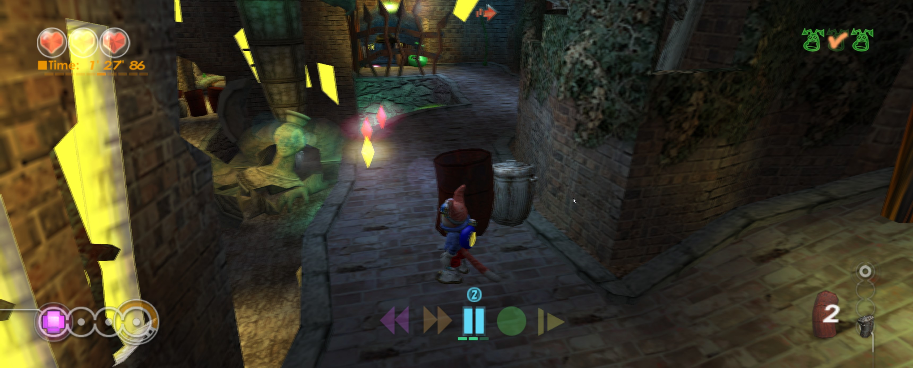
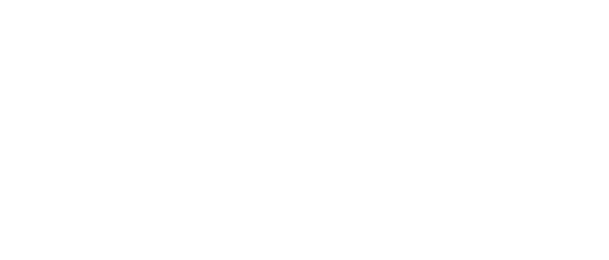

> **Playable public alpha:** Tested through **World 2**. End-to-end completion is **not guaranteed**. Expect bugs and please [file GitHub issues](https://github.com/mstan/BlinxRecomp/issues) with the release version, mods and steps to reproduce.

# Blinx: The Time Sweeper Recompiled

Play Blinx on Windows with adaptive widescreen, higher internal resolution,
controller support and optional gameplay mods through an Xbox-themed launcher.
Built on [XboxLLR](https://github.com/mstan/xboxllr), the early low-level Xbox
recompiler ecosystem.

**[Download the playable Windows x64 alpha](https://github.com/mstan/BlinxRecomp/releases/tag/alpha-2026.10.29.1)**
— no compiler needed. Supply your own supported **NTSC-U** game files.

*Real in-game captures. [Image provenance and rights](docs/screenshots/NOTICE.md).*

## Features

| Feature | Public alpha |
| --- | --- |
| Adaptive widescreen | **Fit to screen**, or fixed aspects from 4:3 through 32:9. The camera expands and gameplay HUD elements follow the appropriate edges. Menus and the Results overlay retain their centered 4:3 layout. |
| Higher resolution | Internal heights up to 2160p, independent of window size. |
| Image quality | Optional FXAA, 2×2 or 3×3 supersampling and anisotropic filtering. Higher settings cost GPU time. |
| Smoother presentation | Optional blended 60/120 Hz presentation at original simulation speed. It can add double edges and one source frame of latency; actual faster simulation is unavailable. |
| Input | Remembered Player 1 controller selection, keyboard input and independent horizontal/vertical camera-invert toggles. |
| Native saves | Persistent in-game progress and loading across process restarts. Keep your console identity with your saves. |
| RAM-backed game cache | Disposable utility-cache contents stay in process memory, allocated on demand within a 750 MiB volume. Native saves remain on disk. |
| Original time controls | PAUSE, SLOW, FAST FORWARD, REWIND and RECORD use the original game logic. Alpha coverage is bounded; report failures. |

Fresh launchers default to adaptive Fit to screen, 1080p internal rendering,
2×2 supersampling, FXAA, 8× filtering and blended 60 FPS presentation.
Change these individually under **Mods**. See [graphics options and costs](docs/GRAPHICS-MODS.md).

### Crystal and time-control modes

These optional **Gameplay** mods are independent and **off by default**:

| Mod | What changes |
| --- | --- |
| **No stage time limit** | Removes the ten-minute failure limit and final 30-second warning. The elapsed clock and Results continue to track real time; the clock is not frozen. |
| **More time-control stock** | Hold up to 20 controls: the original ten slots plus a ten-control reserve, which refills free slots when no control is active. Only the original ten slots persist in native saves; the reserve lasts for the current process. HUD badge art tops out at ten per icon. |
| **Infinite time controls** | Start each stage with one of each of the five controls and keep them after use. Non-heart crystals, including enemy drops, are suppressed except in the final boss stage. Heart crystals remain unchanged. |

Leave those mods off for the original crystal collection and stock rules.
Enabling More stock and Infinite together is supported. None of these modes
changes hearts. [Detailed behavior and validation](docs/CHEATS.md).

## Getting started

1. Extract the entire Windows alpha ZIP into a writable folder and open
   **Start Game.exe**. The launcher, Python and runtime DLLs are included.
2. Choose **Skip** in the optional console-files setup for a new local console
   identity and automatic private save folders. No BIOS, kernel dump, EEPROM
   or large HDD image is needed for new local play.
3. Select your supported NTSC-U `.iso`, `.xiso` or extracted `default.xbe`.
   Disc images import once with progress and Cancel, then reuse `data/discs`.
   An extracted XBE needs its complete game asset folder beside it.
4. Select your controller in **Player 1**, choose **Mods**, then start.

The supported original `default.xbe` SHA-256 is
`e6b7cd8a5527dd001e05bb3e881d9b24ffc58824ff67def394215ddbc8009249`.
Other revisions are unsupported. Original game data is not included.
Linux playable releases remain deferred.

Keep the complete `data` folder, imported-disc cache, selected external save
storage and any `<image>.xboxllr` profile when updating. A virtual identity
is different from your physical Xbox's identity. Original-console save imports
may require the original signing inputs and matching EEPROM in **Settings**.
An explicitly selected raw/QCOW2 FATX HDD image takes priority over folder
storage; close xemu or other writers before sharing it. Xbox Live is unavailable.
See [console and save setup](https://github.com/mstan/xboxllr/blob/master/docs/SETUP.md).

## Alpha coverage and bug reports

**The public playtest scope is through World 2. The game is not guaranteed to
work from beginning to end.** Internal assisted routes, time-control checks and
save/reload tests do not establish every natural puzzle, encounter or later level.
Unreached paths may still stop with diagnostics. This is an early playable alpha.

Please [open a GitHub issue](https://github.com/mstan/BlinxRecomp/issues/new)
with the release version, world/stage, selected mods, Windows/GPU/controller
details and steps to reproduce. Attach a screenshot and the launcher's crash
report where useful, after reviewing it for private information. Do not attach
original game files, console keys or EEPROMs.

Developers: [build instructions](docs/DEVELOPMENT.md),
[current technical status](docs/STATUS.md), [alpha release notes](docs/RELEASE-NOTES-ALPHA-2026.10.29.1.md).

## Credits and license

Development and integration: **Matthew Stanley**. Thanks to **sp00nz / sp00nznet**,
**Phobos**, **NoRain**, the **xemu contributors** and **apexJCL**. The RAM-cache
design was inspired by [apexJCL's Blinx project](https://github.com/apexJCL/blinx1-recomp);
our implementation uses XboxLLR's FATX storage. See [Credits](CREDITS.md) and
[component attribution](THIRD_PARTY_ATTRIBUTION.md).

Owner-original source uses [GPL version 3 or later](LICENSE), subject to
[license scope](LICENSE-SCOPE.md). Other components retain their own terms.
The native executable contains ahead-of-time translated execution code; original
title bodies are generated from the user's matching input. Corresponding project
and prepared dependency source accompany the ZIP. Blinx and its original assets
belong to their respective rights holders. [Original rights notice](RIGHTS-NOTICE.md).
